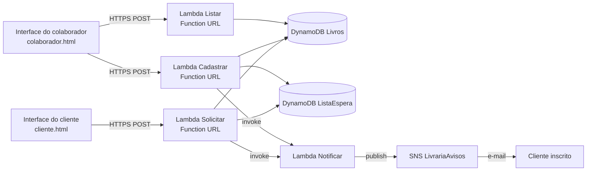
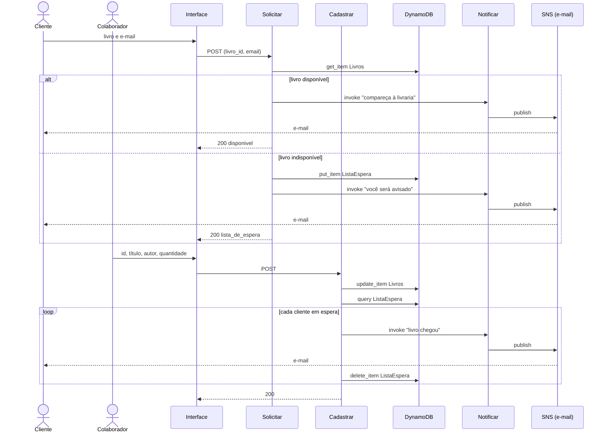

# Relatório: Sebo na AWS

Segundo Trabalho de Distribuição e Concorrência (2026/2).
Integrantes: Arthur Hammond Aragão Poggy e Jayme Augusto Avelino de Paiva
Conta da AWS Academy com a implementação: 3336-9331-7353 (usuário `Arthur_Hammond_Arag__o_Poggy`, região us-east-1)

## 1. Descrição
Aplicação para um sebo na nuvem da Amazon. O cliente informa o livro e o e-mail. Se o livro tem estoque, recebe um e-mail pedindo que compareça à livraria. Se não tem, entra em uma lista de espera e é avisado por e-mail quando o livro chegar. O colaborador cadastra a chegada (ou saída) de exemplares.

## 2. Arquitetura

Serviços usados: AWS Lambda (4 funções), DynamoDB (2 tabelas), SNS (e-mail) e Function URLs (HTTPS). Interfaces em HTML/JavaScript.

### 2.1 Diagrama em blocos

### 2.2 Responsabilidades das funções
| Função | Responsabilidade |
|---|---|
| `Solicitar` | Consulta `Livros`. Com estoque, pede à `Notificar` o aviso de disponibilidade. Sem estoque, grava em `ListaEspera` e avisa que o cliente será chamado. Respostas: 200, 400, 404. |
| `Cadastrar` | Soma a quantidade ao estoque (cria o livro se não existir). Ao chegar exemplar, avisa cada cliente da `ListaEspera` daquele livro e o remove da lista. Saída com estoque insuficiente: 409. |
| `Notificar` | Publica a mensagem no tópico SNS, que entrega o e-mail. |
| `Listar` | Devolve os livros e as quantidades para a tela do colaborador. |

### 2.3 Dados
- `Livros`: `id` (chave), `titulo`, `autor`, `quantidade`.
- `ListaEspera`: `livro_id` (partição), `email` (classificação), `data`.

A chave composta de `ListaEspera` impede duplicar o mesmo cliente para o mesmo livro. A saída de estoque usa uma condição atômica no `update_item` (`quantidade >= :min`), então o estoque nunca fica negativo, mesmo com chamadas simultâneas.

### 2.4 Diagrama de sequência (UML)

Para gerar imagem (PNG/SVG) dos dois diagramas, cole os blocos em https://mermaid.live.

## 3. Instalação e operação
Ver `INSTALACAO_E_OPERACAO.md`.

## 4. O que funcionou
Testado até o momento (resumo T1 a T7):
- `Notificar` pelo console: status 200 e e-mail recebido.
- `Solicitar` pelo console, livro disponível e indisponível: e-mails corretos.
- `Cadastrar` pelo console: execução bem-sucedida.
- `Solicitar` e `Cadastrar` pelas Function URLs com curl: respostas corretas.
- Recusa de saída com estoque insuficiente (409): implementada.

## 5. O que ainda precisa ser testado/preencher (depois de configurar a AWS)
- [x] T10: fluxo "livro disponível" ponta a ponta pelas interfaces.
- [x] T11: fluxo "livro indisponível, depois chega" ponta a ponta pelas interfaces.
- [x] Saída válida com quantidade negativa (usada no T11 para zerar o estoque).
- [ ] Saída com estoque insuficiente (resposta 409).
- [x] Tela de estoque com a Lambda `Listar` (CORS ajustado nas três Function URLs).
- [ ] Anexar capturas de tela dos testes e dos e-mails recebidos.

## 6. Problemas encontrados
| Problema | Causa e solução |
|---|---|
| `Notificar` falhou com *InvalidParameter: Topic Name* | `TOPIC_ARN` não era um ARN válido. Corrigido colando o ARN completo, sem espaços nem aspas. |
| Erro `iam:GetPolicy` na aba Configuração | O Learner Lab bloqueia a leitura das políticas da LabRole. Afeta só o resumo no console. |
| curl devolveu "id e titulo são obrigatórios" | Comando de várias linhas colado sem as quebras. Resolvido rodando em uma linha só. |
| E-mail chega mesmo com `seu@email.com` no JSON | Esperado: o SNS entrega a todos os inscritos; o campo `email` só aparece no texto. |

## 7. Limitações
- Todo inscrito no tópico recebe todos os avisos, de qualquer cliente (simplificação do enunciado).
- As Function URLs usam Auth NONE: quem tiver o endereço pode chamar a função.
- A `ListaEspera` avisa todos os clientes de uma vez; não há controle de quem compra primeiro.
- As interfaces são páginas estáticas locais, sem login.
